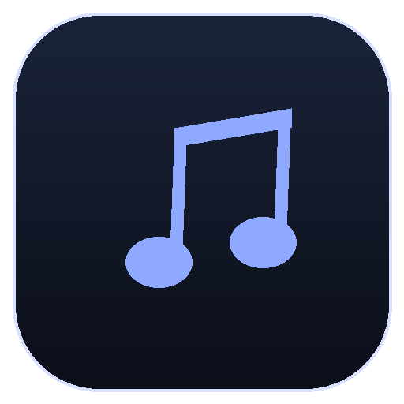

# MUSE — Aesthetic Local Music Library & Player

<div align="center">
  
  <h3>Your music, your atmosphere.</h3>
  <p>Modern, beautiful, offline-first desktop music player with adaptive ambient themes, 9-band EQ, lyrics sync, and song intelligence.</p>
</div>

---

## ✨ Features

- **Local & Offline-First:** Fast playback for MP3, WAV, FLAC, M4A, OGG, and AAC files directly from your disk. Files stay strictly on your device.
- **Adaptive Ambient Theming:** Color palette automatically extracts dominant colors from album covers with WCAG-compliant contrast adjustment and backdrop blur effects.
- **Sound Enhancer & 9-Band EQ:** Full interactive parametric equalizer with presets (Bass Boost, Vocal Clarity, Treble Lift, Acoustic, Electronic, Cinema) + DSP modules:
  - *Clarity*
  - *Ambience (Convolution Reverb)*
  - *Surround Sound (Mid-Side Stereo Widener)*
  - *Dynamic Boost (Compressor)*
  - *Bass Boost*
- **Real-Time Spectrum Visualizer:** 64-band live frequency analyzer rendered at 60 FPS via Canvas & Web Audio API.
- **Song Intelligence & Audio Analysis:**
  - On-device Goertzel & Krumhansl-Schmuckler chroma algorithm for key estimation (e.g. `C major`, `F# minor`).
  - Autocorrelation tempo analysis (BPM).
  - Dynamic range and perceived loudness calculation.
- **Smart Lyrics (Synced & Plain):**
  - Instant loading from ID3 tags.
  - Automatic lookup from public LRCLIB catalog.
  - Drag-and-drop or load custom `.lrc` and `.txt` files with click-to-seek timestamp navigation.
- **Automated Catalog Matching:** Automatic cover art and metadata recovery via MusicBrainz and Cover Art Archive.
- **Custom Libraries:** Create named collections with custom descriptions and artwork covers.

---

## 🚀 Running & Developing

### Prerequisites
- Node.js (v18+)
- npm

### Installation
```bash
git clone https://github.com/Jimsipelaut/muse-app.git
cd muse-app
npm install
```

### Run Desktop App in Development
```bash
npm start
```

---

## 📦 Production Build (Windows .exe)

Build both the **installer setup (.exe)** and **portable executable (.exe)**:

```bash
npm run dist
```

Output binaries will be generated inside the `dist/` directory:
- `MUSE-1.0.0-setup.exe` (NSIS Full Installer with Desktop & Start Menu shortcuts)
- `MUSE-1.0.0-portable.exe` (Single-file executable — run immediately without installation)

---

## 🛠 Tech Stack

- **Framework:** Electron (Desktop Container)
- **UI & DSP:** HTML5, Modern CSS Glassmorphism, Web Audio API, Canvas 2D
- **ID3 Metadata:** Bundled `jsmediatags` (100% offline support)
- **Packaging:** `electron-builder`

---

## 📄 License

MIT License © 2026 [Jimsipelaut](https://github.com/Jimsipelaut)
